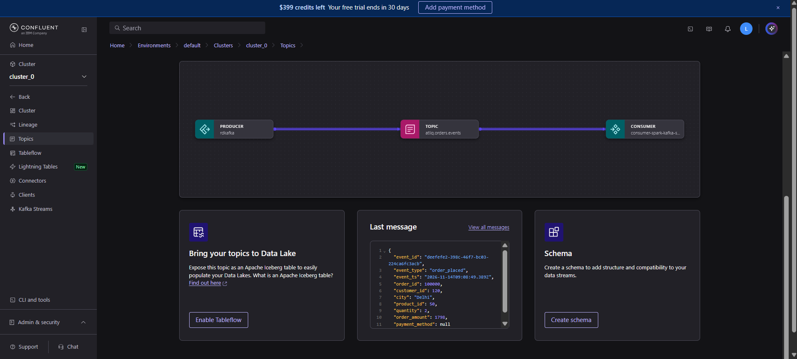
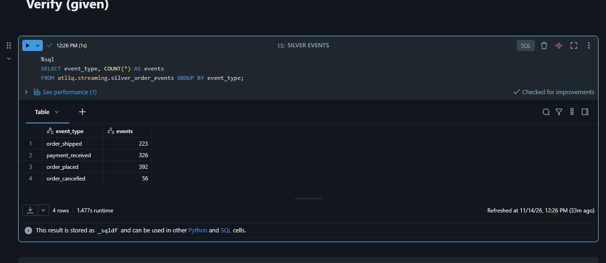
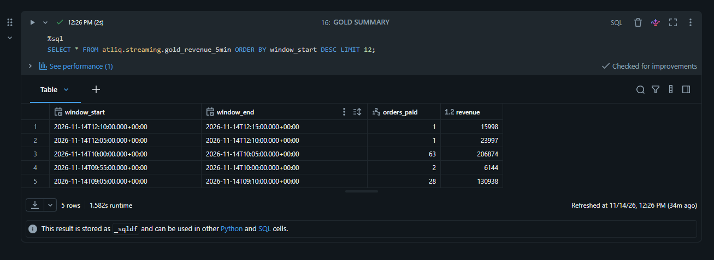
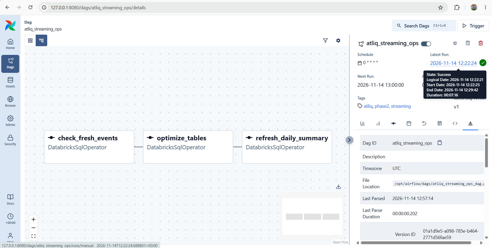
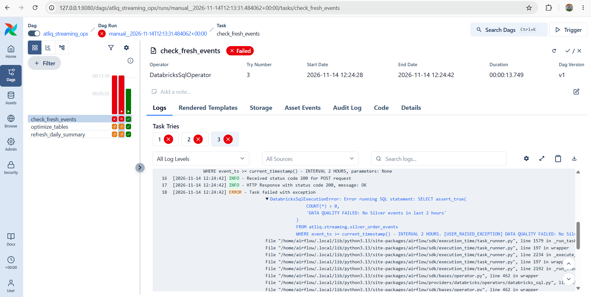
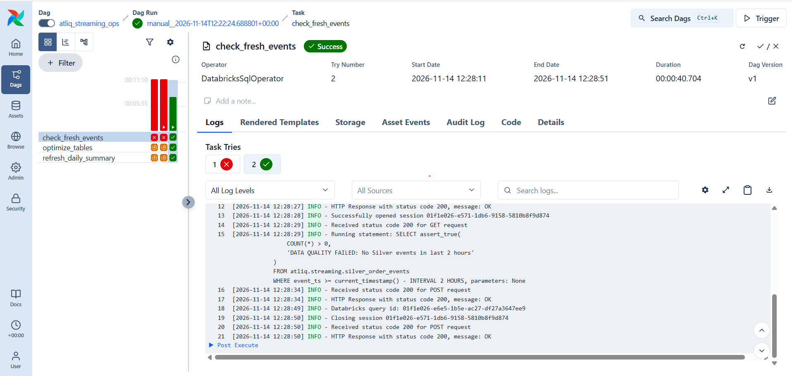

# AtliQ E-Commerce — Phase 2: Real-Time Streaming Data Engineering

## Overview

This phase extends the AtliQ E-Commerce capstone with a streaming order-event pipeline. A Python producer publishes simulated e-commerce events to Kafka; Databricks Structured Streaming processes the events into Delta Lake Silver and Gold tables. Apache Airflow runs hourly data-quality checks, table maintenance, and daily reporting refreshes.

## Architecture

```text
Python order event producer
          |
          v
      Apache Kafka
          |
          v
Databricks Structured Streaming
          |
          v
atliq.streaming.silver_order_events
          |
          +----------------------------+
          |                            |
          v                            v
atliq.streaming.gold_revenue_5min   Daily summary (via Airflow)
                                       |
                                       v
                            atliq.streaming.gold_daily_summary

Airflow (hourly):
check_fresh_events >> optimize_tables >> refresh_daily_summary
```

## Technology Stack

- **Python:** simulated order-event producer
- **Apache Kafka:** event transport
- **Databricks / PySpark Structured Streaming:** stream ingestion and transformations
- **Delta Lake / Databricks SQL:** Silver and Gold tables, quality checks, and maintenance
- **Apache Airflow:** hourly orchestration
- **Docker:** local Airflow environment

## Repository Structure

```text
phase2-streaming-de/
├── airflow/
│   └── dags/
│       └── atliq_streaming_ops_dag.py
├── databricks/
│   └── 01_kafka_stream_processing.py
├── producer/
│   └── order_event_producer.py
├── docs/
│   ├── Airflow_Dag.png
│   ├── Airflow_failed_run.png
│   ├── Airflow_sucess_run.png
│   ├── gold_summary.png
│   ├── Kafka_producer_data.png
│   └── Silver_Events.png
├── requirements.txt
├── .gitignore
└── README.md
```

## Pipeline Components

### 1. Kafka Producer

The Python producer generates simulated order events and publishes them to Kafka.



### 2. Silver Events

Databricks processes incoming events into `atliq.streaming.silver_order_events`.

Example validation query:

```sql
SELECT event_type, COUNT(*) AS total_events
FROM atliq.streaming.silver_order_events
GROUP BY event_type
ORDER BY total_events DESC;
```



### 3. Gold Revenue

The Gold layer aggregates streaming data into five-minute revenue windows in `atliq.streaming.gold_revenue_5min`.

```sql
SELECT *
FROM atliq.streaming.gold_revenue_5min
ORDER BY window_start DESC
LIMIT 20;
```



### 4. Airflow Streaming Operations DAG

The `atliq_streaming_ops` DAG is scheduled hourly and runs three dependent tasks:

1. **`check_fresh_events`** — uses a Databricks SQL assertion to fail if no Silver events arrived in the last two hours.
2. **`optimize_tables`** — performs Delta table maintenance for Silver and Gold data.
3. **`refresh_daily_summary`** — refreshes `atliq.streaming.gold_daily_summary` with daily order and revenue metrics.



The data-quality check was demonstrated failing when recent events were unavailable:



After recent events were available, the DAG completed successfully:



## Running Locally

**Prerequisites:** Python, a working Kafka environment, a Databricks workspace and SQL warehouse, Docker Desktop, and an Airflow environment with the Databricks provider.

1. Configure producer environment variables locally. Do not commit `.env` files or credentials.
2. Start Kafka using your configured environment.
3. Start the producer:

   ```powershell
   python producer/order_event_producer.py
   ```

4. Import and execute `databricks/01_kafka_stream_processing.py` in Databricks. Confirm the Silver and Gold tables receive events.
5. Configure Airflow's `databricks_default` connection with the Databricks workspace host and credentials.
6. Set `SQL_WAREHOUSE_HTTP_PATH` in `airflow/dags/atliq_streaming_ops_dag.py` to your warehouse's HTTP path.
7. Start Airflow, open its UI, and trigger `atliq_streaming_ops`.
8. Verify the three task results and query the daily summary:

   ```sql
   SELECT *
   FROM atliq.streaming.gold_daily_summary
   ORDER BY event_date DESC;
   ```

> Configuration values, authentication, and Kafka startup commands depend on your environment. Never commit personal access tokens, passwords, or `.env` files.

## Evidence and Outcomes

The `docs/` folder contains screenshots of Kafka producer output, Silver events, Gold results, the Airflow DAG, a data-quality failure, and a successful Airflow run.

## Key Learnings

- Event-driven ingestion with Kafka
- Structured Streaming with Databricks and PySpark
- Delta Lake Silver/Gold modeling and windowed aggregations
- Fail-fast freshness checks and operational recovery
- Airflow task dependencies and scheduled maintenance
- Git-based documentation of pipeline execution

---

*AtliQ E-Commerce Data Engineering Capstone — Phase 2*
