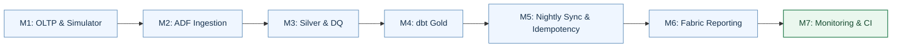
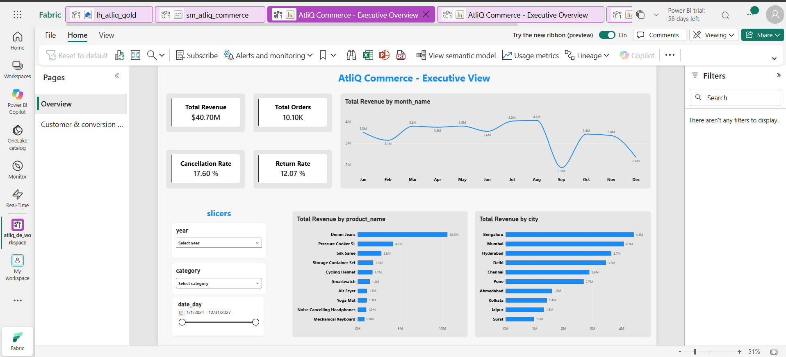

# AtliQ Commerce | End-to-End Data Engineering Capstone

An end-to-end retail analytics pipeline built with **Azure SQL Database, Azure Data Factory, ADLS Gen2, Azure Databricks, Delta Lake, dbt Core, Microsoft Fabric / Power BI, and GitHub Actions**.

This project takes transactional and external source data through a **Bronze → Silver → Gold** lakehouse architecture to deliver reliable business reporting. It includes incremental ingestion, data-quality checks, scheduled execution, audit logging, email alerts, and automated dbt testing.

## At a glance

| Engineering outcome | Verified result |
|---|---|
| **dbt continuous integration** | **19/19 PASS**: 5 Gold tables, 6 staging views, 8 tests |
| **Seed-period sales validation** | **22,959** fact rows and **9,961** valid orders |
| **Data quality** | **1,000** valid customers, **93,436** clean web events, **32** logged DQ rules in the earliest available snapshot |
| **Reliability** | Daily **6:00 AM IST** ADF trigger, SQL audit logging, success/failure email evidence and two-run idempotency comparison |
| **Reporting** | Fabric executive view and customer/conversion analysis, including a session funnel |

**Project repository:** [GitHub source and submission evidence](https://github.com/dheeraj-360/atliq-ecommerce-de)

## 1. Business objective

AtliQ Commerce needs to analyze sales and customer behavior without running heavy reporting workloads against its operational database. The solution supports five business questions:

1. How does revenue change over time?
2. Which products generate the most revenue?
3. Which cities contribute the most revenue?
4. How many purchasing customers are new versus returning?
5. How do website sessions progress from product views to purchases?

## 2. Architecture

```text
Python transaction simulator        Supplier / marketing / clickstream files
            |                                      |
       Azure SQL OLTP                                |
            |                                      |
            +---------- Azure Data Factory --------+
                          |  metadata + watermarks
                          v
                     ADLS Bronze
                          |
                          v
              Databricks Silver (Delta)
                 cleaning, MERGE, DQ log
                          |
                          v
                dbt Gold (star schema)
                  models + data tests
                          |
                          v
               Microsoft Fabric / Power BI

Operations: ADF schedule | Azure SQL audit | email alerts
Version control: GitHub | PR checks: GitHub Actions + dbt CI
```


[Detailed architecture write-up](docs/DE_Architecture/AtliQ_Architecture_One_Page.docx)

**Why separate OLTP and OLAP?** Azure SQL supports normalized transactional writes, while the Databricks / dbt Gold layer is designed for analytical queries. This keeps reporting workloads away from the operational source.

## 3. Milestone roadmap

All seven implementation milestones are complete. The flow below is a **milestone roadmap**, not a claim that every stage is executed inside one ADF pipeline.



| Milestone | Key deliverable | Status |
|---|---|---|
| **M1** | Normalized Azure SQL OLTP schema, seed data and daily simulator | Complete |
| **M2** | Metadata-driven ADF full/incremental ingestion to Bronze | Complete |
| **M3** | PySpark cleaning, Delta MERGE, clickstream processing and DQ log | Complete |
| **M4** | dbt Gold fact/dimension models and tests | Complete |
| **M5** | Scheduled incremental processing and two-run idempotency evidence | Complete |
| **M6** | Fabric executive and customer/conversion reporting | Complete |
| **M7** | SQL run audit, email alerts, retries and PR-based dbt CI | Complete |

## 4. Implementation

| Layer | What was implemented |
|---|---|
| **OLTP** | Five Azure SQL tables: `customers`, `products`, `orders`, `order_items`, `payments`; ETL metadata/control table; Python daily transaction simulator. |
| **Bronze** | One metadata-driven ADF SQL ingestion design using full and watermark-based incremental loads, plus ingestion of external files into ADLS Gen2. |
| **Silver** | Databricks/PySpark notebooks that clean and standardize data, apply Delta `MERGE`, handle clickstream data, and record results in `atliq_dl.silver.dq_log`. |
| **Gold** | dbt staging models and analytics tables in `atliq_dl.gold`, including `fact_sales`, `dim_customers`, `dim_product`, `dim_date`, and `fact_web_sessions`. |
| **Reporting** | Fabric semantic model and Power BI pages for executive metrics, product/city performance, customer behavior, and a conversion funnel. |
| **Reliability** | ADF nightly trigger, Azure SQL pipeline audit, success/failure email notifications, idempotency checks, and GitHub Actions CI. |

### Executive dashboard preview



The repository also contains the [customer and conversion dashboard](docs/Customer_conversion_Analysis.png) and the [Fabric semantic model](docs/Fabric_semantic_model.png). They are linked rather than embedded to keep this overview readable.

### Incremental sync and idempotency

ADF reads table-specific configuration from the ETL control table, uses watermarks for incremental sources, and advances the watermark after successful ingestion. Databricks merges updated business records into Silver instead of appending duplicates. A no-new-data run should leave analytical results unchanged.

Idempotency was tested by running the pipeline twice without changing the source and comparing Gold fact-row counts and gross revenue. The captured before/after results were unchanged. Evidence is stored under `docs/idempotency/`.

### Reporting definitions

- **Gross revenue:** Sales revenue excluding Cancelled orders; Returned orders remain included.
- **Returned revenue:** Revenue associated with Returned orders.
- **Net revenue:** Gross revenue minus Returned revenue.
- **Conversion funnel:** Sessions → Product views → Add to cart → Checkout → Purchase.

## 5. Data quality and validation

The initial data includes deliberately messy values, such as test accounts, inconsistent categories, duplicate events, malformed clickstream records, and bot traffic. Silver cleaning rules are logged per run. The **31 October 2026** snapshot is the **earliest available log**, treated as candidate seed-run evidence rather than a confirmed initial run ID.

| Seed-period checkpoint | Guide | Actual |
|---|---:|---:|
| Valid customers | 1,000 | 1,000 |
| Products | 60 | 60 |
| Valid orders | 9,961 | 9,961 |
| Gold fact sales rows | 22,959 | 22,959 |
| Gross revenue | ₹32,424,661 | ₹32,424,661 |
| Returned revenue | ₹4,574,944 | ₹4,631,542 |
| Net revenue | ₹27,849,717 | ₹27,793,119 |
| Clean web events | 93,436 | 93,436 |
| Malformed clickstream events | 426 | 426 |

The **₹56,598** difference in returned and net revenue is consistent with existing orders moving to `Returned` status through the simulator's update functionality. This interpretation is supported by the status counts but individual historical transitions were not independently confirmed. Other Section 7.7 benchmarks require like-for-like definitions before claiming a match.

[Data Quality Report](docs/DQ_Log/AtliQ_Data_Quality_Report_Final.docx) · [DQ rule-count CSV](docs/DQ_Log/dq_log_seed.csv)

## 6. Scheduling, monitoring, and CI

- **Nightly schedule:** ADF trigger `tr_atliq_nightly_0600_ist`, configured for **6:00 AM IST**.
- **Operational audit:** Azure SQL `etl.pipeline_run_audit` records execution status, timestamps and available error details.
- **Alerts:** Success and failure notifications through Azure monitoring/email configuration.
- **Retry resilience:** Three retries at 30-second intervals on the audit stored-procedure activities (`audit_run_started`, `audit_run_failed`, `audit_run_succeeded`) to handle transient connectivity problems.
- **dbt CI:** A GitHub Actions workflow runs `dbt deps` and `dbt build --target ci` on pull requests to `main`. A recorded run passed **19/19 nodes** (5 tables, 6 views, 8 tests), with no errors.

The CI build targets `atliq_dl.ci`, separate from the reporting Gold schema. CI validates code but does not deploy production models automatically.

## 7. Reliability case study: An actual scheduled-run failure

**Incident: 12 November 2026, 6:00 AM IST.** The ADF schedule fired, but its `audit_run_started` stored-procedure activity failed with **ADF error 2402**:

> Server provided routing information, but timeout already expired.

This error occurred at the Azure SQL audit stage, before ingestion began. The `audit_run_failed` handler also encountered a failure, illustrating a practical limitation: database-backed audit logging can itself become unavailable when the database connection fails.

| Stage | Investigation and response |
|---|---|
| **Detection** | ADF activity-level monitoring identified `audit_run_started` as the failed activity. |
| **Investigation** | The Azure SQL linked-service test succeeded afterward. This supports a possible transient connectivity issue, but does not prove the exact root cause. |
| **Improvement** | Added **3 retries**, spaced **30 seconds** apart, to `audit_run_started`, `audit_run_failed`, and `audit_run_succeeded`, then published the configuration. |
| **Validation** | Re-ran the pipeline after the change. This confirms the workflow can execute again; the retry mechanism itself is not proven to have been exercised unless attempt logs show it. |
| **Takeaway** | Scheduling, external alerting, audit logging and connection retries are complementary reliability controls, not substitutes for one another. |

**Why this matters:** A green CI run and a working schedule do not guarantee every nightly execution will succeed. Detecting a real failure and strengthening the recovery path demonstrates operational ownership rather than only implementation.

Supporting evidence is available in [`docs/`](docs/), including [trigger run](docs/PL_Trigger_run.png), [failure alert](docs/Failed_pipeline_alert.png), [success email](docs/Sucess_Alert_email.png) and [failure audit evidence](docs/Audit_log_failed_runs.png). The audit screenshot may represent a different test run; it is not presented as proof that this specific November 12 failure was written to SQL.

## 8. Project structure

```text
atliq-ecommerce-de/
├── sql/                     # OLTP and pipeline audit scripts
├── scripts/                 # Daily order simulator
├── adf/                     # ADF source configuration
├── databricks/
│   ├── notebooks/           # Silver and DQ processing
│   └── jobs/                # Exported job configuration
├── atliq_gold/              # dbt project, models and tests
├── fabric/                  # Power BI report (.pbix)
├── docs/                    # Architecture, DQ report, validation evidence
├── .github/workflows/       # dbt CI workflow
├── .env.example             # Safe environment-variable template
└── README.md
```

The `adf_publish` branch contains ADF-generated deployment artifacts and is kept separate from the main source branch.

## 9. How to run

**Prerequisites:** Access to the provisioned Azure SQL Database, Data Factory, ADLS Gen2, Azure Databricks workspace, Databricks SQL warehouse, and Fabric; Python and ODBC Driver 18 for SQL Server; required credentials supplied securely.

**1. Prepare the Python environment** (from the repository root):

```powershell
python -m venv .venv
.\.venv\Scripts\Activate.ps1
pip install -r requirements.txt
```

Create a local `.env` using `.env.example` if the example file is present. Do not commit `.env`, database passwords or tokens.

**2. Generate transactional changes:**

```powershell
python scripts/daily_order_simulator.py --orders 20 --update-existing 5
```

**3. Run ingestion and transformations:** Trigger the configured ADF master pipeline (`pl_atliq_nightly sync`) or use its daily schedule; check downstream Databricks Silver job execution and build the dbt Gold project using the configured target.

**4. Build and test dbt:** From `atliq_gold/`, with Databricks connection environment variables configured:

```powershell
dbt deps
dbt build --target ci --profiles-dir .
```

Use the `ci` target for validation; the production Gold target is separate. Open the Fabric Power BI report after model data has refreshed to review business metrics.

## 10. Submission artifacts

The `main` branch contains the source implementation, including ADF definitions, Databricks notebooks/job configuration, dbt models/tests, the Fabric PBIX, and supporting documentation. The `docs/` directory also contains [CI evidence](docs/CI-CD_test.png), [idempotency comparison](docs/idempotency/Results_before_after_run_same.png), [scheduled trigger evidence](docs/PL_Trigger_run.png), monitoring alerts and dashboard images. Most screenshots are kept as separate linked files; only the architecture and one executive dashboard screenshot are embedded for quick review.

**More evidence:** [PR merge](docs/PR_merge.png) | [SQL audit runs](docs/idempotency/audit_log_sucessive_runs.png) | [DQ log CSV](docs/DQ_Log/dq_log_seed.csv) | [Architecture write-up](docs/DE_Architecture/AtliQ_Architecture_One_Page.docx).

**Project scope:** A working end-to-end capstone implementation, not a fully automated production deployment. Cloud resources, access permissions and environment-specific connections must be configured to reproduce it.

---

*Built for the Codebasics AtliQ Commerce End-to-End Data Engineering Capstone.*
